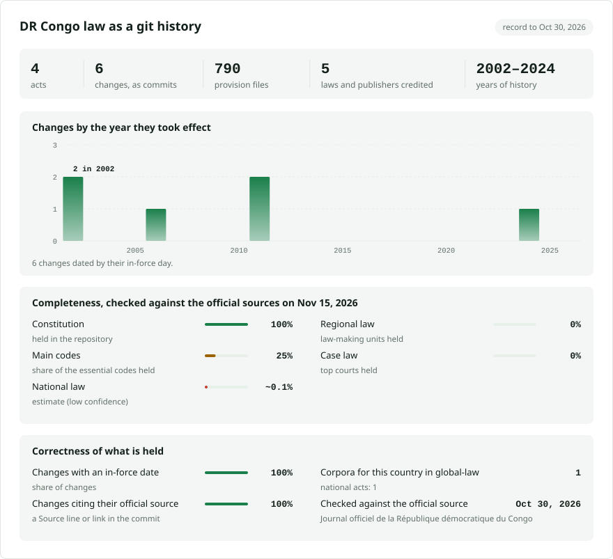

# DR Congo: law history in git

[Français](README.md) · **English**

<picture>
<source media="(prefers-color-scheme: dark)" srcset="data/effort-dark.svg">

</picture>

The law of the Democratic Republic of the Congo as a git history: one file per article, each version committed on the day it took effect, and the law that made each change as the commit's author. `git blame` names the law behind every paragraph; `git log` lists every change to an article; picking a date gives the text in force that day.

Part of [lexifina/global-law](https://github.com/lexifina/global-law), one git history for every country's law: this is DR Congo's national law, which global-law reads at `dr-congo/national/acts/`.

**What is in it now:** the Constitution of 18 February 2006 in three versions (as promulgated, as revised by Loi n° 11/002, and the coordinated text of 5 February 2011); nine codes: the Code du travail, the Code de procédure pénale, the Code de conduite de l’agent public, the Code pénal (coordinated text of 5 March 2024), the Code de la famille (1987, then as amended by Loi n° 16/008 of 2016), the Code de procédure civile and Book III of the Civil Code (coordinated texts), the 2002 Code minier and the land law, Loi n° 73-021 (as amended in 1980); two OHADA uniform acts (security interests and cooperatives, `ohada/`); and some 1,500 laws, ordinances-laws, decrees, orders and provincial edicts, each as enacted on the day it took effect, most of them from 2000 on. Each act's `README.md` ([`constitution/README.md`](constitution/README.md)) lists every provision, how often it changed and when.

Each act is a folder with one file per article, filed by type and year ([STRUCTURE.md](STRUCTURE.md)): `constitution/`, `codes/<code>/`, `lois/<year>/`, `ordonnances-lois/`, `decrets-lois/`, `ordonnances/`, `decrets/`, `arretes/` and the provinces' `edits-provinciaux/` and `arretes-provinciaux/`. `codes/code-du-travail/art-140.md` is Article 140 of the Code du travail, on annual leave.

The text is in French, as the Journal officiel prints it. An English translation is not part of this record.

## Questions as git commands

| Question | Command |
| --- | --- |
| Every change to Article 140 of the Code du travail (annual leave) | `git log -p --word-diff -- codes/code-du-travail/art-140.md` |
| Which law wrote each line of Article 140? | `git blame codes/code-du-travail/art-140.md` |
| Every version of Article 140, with the day each took effect | `git log --format="%h %(trailers:key=In-force,valueonly,separator=) %an" -- codes/code-du-travail/art-140.md` |
| Article 140 as in force on 1 January 2020 | `python tools/en_vigueur_au.py 2020-01-01 codes/code-du-travail 140` |

The Code du travail has one version here; for an article with two, try `constitution/art-071.md` (Article 71, the election of the President, rewritten by Loi n° 11/002).

**Outside git**, we also host this record publicly, for free:

- **[Ask Claude about the law of DR Congo](https://global-law.lexifina.com/v1/try_claude?country=dr-congo)**: opens Claude with a first question ready.
- **[Ask ChatGPT](https://global-law.lexifina.com/v1/try_chatgpt?country=dr-congo)**: the same question in ChatGPT.
- **[Search the law of DR Congo on our site](https://lexifina.com/law?country=dr-congo&q=cong%C3%A9+annuel)**: a search for "congé annuel" (annual leave), with each provision's text and its versions, no account needed.
- **[Developer REST API](https://global-law.lexifina.com/v1/search_law?query=cong%C3%A9+annuel&jurisdiction=dr-congo)**: the same search as JSON, with no key. See the [documentation here](https://lexifina.com/api/global-law).

Both assistants read the record through the free Global law connector (MCP, `https://global-law.lexifina.com/mcp`); the first time, the chat gives you the link that adds it. Ask in French or in English.

**Host it yourself easily.** All it takes is git and Python, and the tools run on your machine:

```sh
git clone --depth 1 https://github.com/lexifina/global-law && cd global-law
python3 tools/countries.py add dr-congo/national/acts
python3 tools/law.py show 2026-01-01 dr-congo/national/acts/codes/code-du-travail/art-140.md
```

Opened in Claude Code, Cursor, VS Code or Codex, the clone also starts a local MCP server with the same tools ([MCP.md](https://github.com/lexifina/global-law/blob/main/MCP.md)).

## Dates

Each commit is dated at noon, Africa/Kinshasa, on the day the version took effect, and carries it in its `In-force:` trailer (the day of signature is in `Enacted:`):

- the Constitution: 18 February 2006, its promulgation (art. 229: in force "dès sa promulgation"); Loi n° 11/002: 20 January 2011, its promulgation (its art. 3); the coordinated text: 5 February 2011, the date of the Journal officiel numéro spécial that published it;
- the Code du travail: 16 October 2002, its promulgation (art. 334); the Code de conduite de l’agent public: 3 October 2002, its signature (art. 33);
- the Code de procédure pénale: 12 March 2024, the date of the Journal officiel numéro spécial that published its coordinated text ("mise à jour au 12 mars 2024").

Each change is credited to the law that made it (`Loi n° 11/002`); the committer is always Lexifina. The two coordinated texts are credited to the Journal officiel: that of 2011 as "unexplained", since no law made its 55 differences from the promulgated wording (punctuation, capitals, spelling, small words), and the Code de procédure pénale as the oldest version available, naming the twelve texts that amended it from 1959 to 2023.

## How it is checked

- `tools/check_repo.py` reads every version back from git on the day it took effect and on the day before, and both must match the corpus the history was built from; it also checks that every commit's trailers parse and that there are no merge commits.
- `tools/build.py` writes the history from that corpus in one pass, and a second build gave identical hashes; new acts are appended on top of `main` by `tools/append.py`, which rewrites nothing. The results are in [`REPRODUCE.md`](REPRODUCE.md).
- Today's Constitution against the Journal officiel's own site: 901 of its 906 paragraphs appear there word for word, the other 5 only where the site's copy is broken.
- A second copy for two codes: Leganet's HTML edition of the Code du travail agrees letter for letter in 1,066 of 1,110 paragraphs (the other 44 are misprints of the Journal officiel, kept as printed, "oe"/"œ" spellings or small words); all 181 articles of the Code de procédure pénale agree word for word with Leganet's copy of the same issue, apart from three words that copy splits across a line break.
- [vulnerabilities/](vulnerabilities/README.en.md): possible drafting mistakes in this law, found by global-law's detectors and checked by hand. Not run yet.

## What it does not show

- **Today's Code du travail.** Loi n° 16/010 of 15 July 2016 rewrote 15 articles and added two (61 bis and 61 ter); its Journal officiel issue and day of entry into force have not been sourced, so this record gives the 2002 text. Article 140 is not among them.
- **The Code de procédure pénale before 2024**: the twelve amending texts are named, but their changes are not replayed.
- **Consolidated versions of most acts**: the laws, ordinances, decrees and orders are filed as enacted, each in its own folder; amending acts are not yet replayed into the acts they amend. Acts whose page gives no in-force clause, or whose day of entry into force cannot be fixed from the page (for example "thirty days after publication" with no Journal officiel date), are held back, as are pages with an incomplete text. Also missing: the constitutions of 1960, 1964, 1967 and 2003.
- **Headings and non-operative text**: headings are in `structure.md`, not in the article files; the exposés des motifs are left out; texts published only as scanned images are not transcribed.

## Sources

| Source | Kind | Past versions | Notes |
| --- | --- | --- | --- |
| [Journal officiel de la RDC](https://journalofficiel.cd/textes-phares/codes-en-vigueur) | The official gazette; its "Textes phares" pages carry the coordinated texts it marks in force | no, today's text only | The Code de procédure pénale and the Code de conduite de l’agent public; the check of today's Constitution |
| [Leganet](https://www.leganet.be/JO.htm) | Copies of Journal officiel issues, as PDFs with a text layer | each issue as published | The Constitution (JO of 18 February 2006), Loi n° 11/002 (JO of 1 February 2011), the coordinated text of 5 February 2011 and the Code du travail (JO of 25 October 2002); its copies of the codes for checking |
| [Leganet](https://www.leganet.be/legislation.htm) (an association's site, PPDS) | HTML transcriptions of the texts published in the Journal officiel, with the issue they appeared in | each act as enacted | The laws, ordinances, decrees and orders in `lois/`, `ordonnances-lois/`, `decrets/`, `arretes/` and the provinces' folders; tagged `Source-status: secondary copy (Leganet ...)` |
| [Journal officiel de la RDC](https://journalofficiel.cd/) (the gazette's site) | The text the site gives for each act it published, with the issue date | each act as enacted | Some 600 laws, ordinances-laws, decrees and orders, mostly 2018 to 2025, not on Leganet; tagged `Source-status: official (Journal officiel ...)` |
| [Leganet](https://www.leganet.be/legislation.htm), PDFs | The Code minier (JO of 15 July 2002) and the land law (JO numéro spécial of 1 December 2004), PDFs with a text layer; HTML transcriptions of the Code de procédure civile and Book III of the Civil Code | coordinated texts only, for the last two | `codes/` |
| [Journal officiel de l’OHADA](https://www.ohada.org/journal-officiel/) | Issues 22 and 23 (15 February 2011), PDFs with a text layer | each act as adopted | `ohada/`: in force in the DRC from 12 September 2012 (accession, Treaty art. 53); the other uniform acts are only scans on ohada.org |

## Licence

See [`LICENSE`](LICENSE). The texts are official texts of the Journal officiel de la République Démocratique du Congo, reproduced with attribution to it and to Leganet, which hosts the copies used; neither publishes a licence, and their copyright status is not confirmed here. The history, commit messages, tables and tools are CC0 1.0.

No AI model wrote, translated or corrected legal text, and none runs when the history is built; the scripts were written by an AI model (see [`REPRODUCE.md`](REPRODUCE.md)).

## Visualisations

- [visualisations/](visualisations/README.en.md): charts drawn from this repository. Not drawn yet.

## More

From [lexifina/global-law](https://github.com/lexifina/global-law):

- [FEATURES.md](https://github.com/lexifina/global-law/blob/main/FEATURES.md): every feature, and what every corpus must support (`git blame`, `law.py`, the MCP tools)
- [FAQ.md](https://github.com/lexifina/global-law/blob/main/FAQ.md): questions and answers · [CONTRIBUTING.md](https://github.com/lexifina/global-law/blob/main/CONTRIBUTING.md): proposing changes · [MCP.md](https://github.com/lexifina/global-law/blob/main/MCP.md): the MCP server · [REPRODUCE.md](https://github.com/lexifina/global-law/blob/main/REPRODUCE.md): how it was built · [CHANGELOG.md](https://github.com/lexifina/global-law/blob/main/CHANGELOG.md)
- [FRESHNESS.md](https://github.com/lexifina/global-law/blob/main/FRESHNESS.md): how current each corpus is · [Monitoring](https://github.com/lexifina/global-law/tree/main/monitoring): whether updates are running · [WATCHING.md](https://github.com/lexifina/global-law/blob/main/WATCHING.md): how each official source is watched for changes
- [performance/](https://github.com/lexifina/global-law/tree/main/performance): how fast the tools are, measured
- [visualisations/](https://github.com/lexifina/global-law/tree/main/visualisations): charts and bridges across the world's law
- [Vulnerabilities](https://github.com/lexifina/global-law/tree/main/vulnerabilities): mistakes in legislation as published
