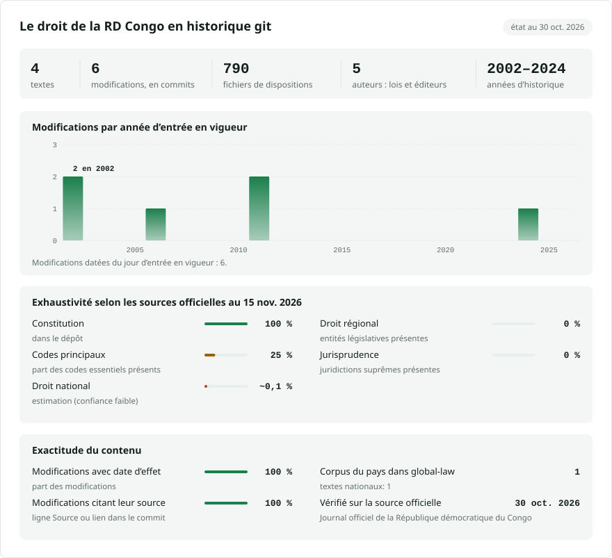

# RD Congo : l’historique du droit dans git

**Français** · [English](README.en.md)

<picture>
<source media="(prefers-color-scheme: dark)" srcset="data/fr/effort-dark.svg">

</picture>

Le droit de la République démocratique du Congo sous forme d’historique git : un fichier par article, chaque version enregistrée au jour de son entrée en vigueur, et pour auteur de chaque commit la loi qui a apporté la modification. `git blame` désigne la loi à l’origine de chaque alinéa ; `git log` énumère toutes les modifications d’un article ; le choix d’une date donne le texte en vigueur ce jour-là.

Fait partie de [lexifina/global-law](https://github.com/lexifina/global-law), un historique git unique pour le droit de chaque pays : ce dépôt contient le droit national de la RD Congo, que global-law lit dans `dr-congo/national/acts/`.

**Contenu actuel :** la Constitution du 18 février 2006 en trois versions (telle que promulguée, telle que révisée par la loi n° 11/002, et le texte coordonné du 5 février 2011) ; neuf codes : le Code du travail, le Code de procédure pénale, le Code de conduite de l’agent public, le Code pénal (textes coordonnés du 5 mars 2024), le Code de la famille (1987, puis tel que modifié par la loi n° 16/008 de 2016), le Code de procédure civile et le Livre III du Code civil (textes coordonnés), le Code minier de 2002 et la loi foncière n° 73-021 (telle que modifiée en 1980) ; deux actes uniformes OHADA (sûretés et sociétés coopératives, `ohada/`) ; et quelque 1 500 lois, ordonnances-lois, décrets, arrêtés et édits provinciaux, chacun tel qu’édicté, au jour de son entrée en vigueur, la plupart postérieurs à 2000. Le `README.md` de chaque texte ([`constitution/README.md`](constitution/README.md)) énumère chaque disposition, le nombre de ses modifications et leurs dates.

Chaque texte est un dossier comportant un fichier par article, classé par nature et par année ([STRUCTURE.md](STRUCTURE.md)) : `constitution/`, `codes/<code>/`, `lois/<année>/`, `ordonnances-lois/`, `decrets-lois/`, `ordonnances/`, `decrets/`, `arretes/` et, pour les provinces, `edits-provinciaux/` et `arretes-provinciaux/`. `codes/code-du-travail/art-140.md` est l’article 140 du Code du travail, relatif au congé annuel.

Le texte est en français, tel que l’imprime le Journal officiel. Une traduction anglaise ne fait pas partie de ce registre.

## Questions sous forme de commandes git

| Question | Commande |
| --- | --- |
| Toutes les modifications de l’article 140 du Code du travail (congé annuel) | `git log -p --word-diff -- codes/code-du-travail/art-140.md` |
| Quelle loi a écrit chaque ligne de l’article 140 ? | `git blame codes/code-du-travail/art-140.md` |
| Toutes les versions de l’article 140, avec le jour d’entrée en vigueur de chacune | `git log --format="%h %(trailers:key=In-force,valueonly,separator=) %an" -- codes/code-du-travail/art-140.md` |
| L’article 140 tel qu’en vigueur le 1er janvier 2020 | `python tools/en_vigueur_au.py 2020-01-01 codes/code-du-travail 140` |

Le Code du travail figure ici en une seule version ; pour un article qui en compte deux, essayez `constitution/art-071.md` (article 71, relatif à l’élection du Président de la République, réécrit par la loi n° 11/002).

**En dehors de git**, nous hébergeons aussi ce registre publiquement, gratuitement :

- **[Interroger Claude sur le droit de la RD Congo](https://global-law.lexifina.com/v1/try_claude?country=dr-congo)** : ouvre Claude avec une première question prête.
- **[Interroger ChatGPT](https://global-law.lexifina.com/v1/try_chatgpt?country=dr-congo)** : la même question dans ChatGPT.
- **[Rechercher dans le droit de la RD Congo sur notre site](https://lexifina.com/law?country=dr-congo&q=cong%C3%A9+annuel)** : une recherche de « congé annuel », avec le texte de chaque disposition et ses versions, sans compte.
- **[API REST pour les développeurs](https://global-law.lexifina.com/v1/search_law?query=cong%C3%A9+annuel&jurisdiction=dr-congo)** : la même recherche en JSON, sans clé. Voir la [documentation ici](https://lexifina.com/api/global-law).

Les deux assistants lisent le registre au moyen du connecteur gratuit Global law (MCP, `https://global-law.lexifina.com/mcp`) ; la première fois, la conversation vous donne le lien qui l’ajoute. Posez vos questions en français ou en anglais.

**L’héberger vous-même, simplement.** Il suffit de git et de Python, et les outils s’exécutent sur votre machine :

```sh
git clone --depth 1 https://github.com/lexifina/global-law && cd global-law
python3 tools/countries.py add dr-congo/national/acts
python3 tools/law.py show 2026-01-01 dr-congo/national/acts/codes/code-du-travail/art-140.md
```

Ouvert dans Claude Code, Cursor, VS Code ou Codex, le clone lance aussi un serveur MCP local doté des mêmes outils ([MCP.md](https://github.com/lexifina/global-law/blob/main/MCP.md)).

## Dates

Chaque commit est daté à midi, heure de Kinshasa (Africa/Kinshasa), du jour où la version est entrée en vigueur, et porte ce jour dans son trailer `In-force:` (le jour de la signature figure dans `Enacted:`) :

- la Constitution : le 18 février 2006, sa promulgation (art. 229 : en vigueur « dès sa promulgation ») ; la loi n° 11/002 : le 20 janvier 2011, sa promulgation (son art. 3) ; le texte coordonné : le 5 février 2011, date du numéro spécial du Journal officiel qui l’a publié ;
- le Code du travail : le 16 octobre 2002, sa promulgation (art. 334) ; le Code de conduite de l’agent public : le 3 octobre 2002, sa signature (art. 33) ;
- le Code de procédure pénale : le 12 mars 2024, date du numéro spécial du Journal officiel qui a publié son texte coordonné (« mise à jour au 12 mars 2024 »).

Chaque modification est attribuée à la loi qui l’a faite (`Loi n° 11/002`) ; le committer est toujours Lexifina. Les deux textes coordonnés sont attribués au Journal officiel : celui de 2011 en tant que modification « inexpliquée », aucune loi n’étant à l’origine de ses 55 différences avec la rédaction promulguée (ponctuation, majuscules, orthographe, petits mots), et le Code de procédure pénale en tant que plus ancienne version disponible, avec mention des douze textes qui l’ont modifié de 1959 à 2023.

## Comment il est vérifié

- `tools/check_repo.py` relit chaque version depuis git au jour de son entrée en vigueur et la veille, et les deux doivent correspondre au corpus à partir duquel l’historique a été construit ; il vérifie aussi que les trailers de chaque commit se lisent sans erreur et qu’il n’existe aucun commit de fusion.
- `tools/build.py` écrit l’historique à partir de ce corpus en une seule passe, et une seconde construction a donné des empreintes identiques ; les nouveaux textes sont ajoutés au-dessus de `main` par `tools/append.py`, qui ne réécrit rien. Les résultats figurent dans [`REPRODUCE.md`](REPRODUCE.md).
- La Constitution actuelle, comparée au site même du Journal officiel : 901 de ses 906 alinéas y figurent mot pour mot, les 5 autres seulement là où la copie du site est défectueuse.
- Une seconde copie pour deux codes : l’édition HTML du Code du travail de Leganet concorde lettre pour lettre pour 1 066 des 1 110 alinéas (les 44 autres sont des coquilles du Journal officiel, conservées telles qu’imprimées, des graphies « oe »/« œ » ou des petits mots) ; les 181 articles du Code de procédure pénale concordent tous mot pour mot avec la copie du même numéro tenue par Leganet, à l’exception de trois mots que cette copie coupe par un saut de ligne.
- [vulnerabilities/](vulnerabilities/): erreurs de rédaction possibles dans ce droit, trouvées par les détecteurs de global-law et vérifiées à la main. Pas encore lancé.

## Ce qu’il ne montre pas

- **Le Code du travail en vigueur aujourd’hui.** La loi n° 16/010 du 15 juillet 2016 a réécrit 15 articles et en a ajouté deux (61 bis et 61 ter) ; le numéro du Journal officiel qui l’a publiée et le jour de son entrée en vigueur n’ont pas été trouvés dans une source, de sorte que ce registre donne le texte de 2002. L’article 140 ne fait pas partie de ces articles.
- **Le Code de procédure pénale avant 2024** : les douze textes modificatifs sont nommés, mais leurs modifications ne sont pas rejouées.
- **Les versions consolidées de la plupart des textes** : les lois, ordonnances, décrets et arrêtés figurent tels qu’édictés, chacun dans son dossier ; les textes modificatifs ne sont pas encore reportés dans les textes qu’ils modifient. Les textes dont la page ne donne pas de clause d’entrée en vigueur, ou dont le jour d’entrée en vigueur ne peut être fixé à partir de la page (par exemple « trente jours après sa publication » sans date du Journal officiel), sont mis de côté, de même que les pages au texte incomplet. Manquent aussi les constitutions de 1960, 1964, 1967 et 2003.
- **Les intitulés et le texte non normatif** : les intitulés figurent dans `structure.md`, et non dans les fichiers des articles ; les exposés des motifs sont omis ; les textes publiés uniquement sous forme d’images numérisées ne sont pas transcrits.

## Sources

| Source | Nature | Versions antérieures | Remarques |
| --- | --- | --- | --- |
| [Journal officiel de la RDC](https://journalofficiel.cd/textes-phares/codes-en-vigueur) | Le journal officiel ; ses pages « Textes phares » présentent les textes coordonnés qu’il indique comme en vigueur | non, le seul texte actuel | Le Code de procédure pénale et le Code de conduite de l’agent public ; la vérification de la Constitution actuelle |
| [Leganet](https://www.leganet.be/JO.htm) | Copies de numéros du Journal officiel, en PDF dotés d’une couche texte | chaque numéro tel que publié | La Constitution (JO du 18 février 2006), la loi n° 11/002 (JO du 1er février 2011), le texte coordonné du 5 février 2011 et le Code du travail (JO du 25 octobre 2002) ; ses copies des codes, pour vérification |
| [Leganet](https://www.leganet.be/legislation.htm) (site associatif de l’ASBL PPDS) | Transcriptions HTML des textes publiés au Journal officiel, avec le numéro qui les a publiés | chaque texte tel qu’édicté | Les lois, ordonnances, décrets et arrêtés de `lois/`, `ordonnances-lois/`, `decrets/`, `arretes/` et des dossiers provinciaux ; marqués `Source-status: secondary copy (Leganet ...)` |
| [Journal officiel de la RDC](https://journalofficiel.cd/) (site du Journal officiel) | Le texte que le site donne pour chaque acte publié, avec la date du numéro | chaque texte tel qu’édicté | Quelque 600 lois, ordonnances-lois, décrets et arrêtés, surtout de 2018 à 2025, absents de Leganet ; marqués `Source-status: official (Journal officiel ...)` |
| [Leganet](https://www.leganet.be/legislation.htm), PDF | Le Code minier (JO du 15 juillet 2002) et la loi foncière (JO, numéro spécial du 1er décembre 2004), PDF à couche texte ; transcriptions HTML du Code de procédure civile et du Livre III du Code civil | les textes coordonnés seulement, pour ces deux derniers | `codes/` |
| [Journal officiel de l’OHADA](https://www.ohada.org/journal-officiel/) | Les numéros 22 et 23 (15 février 2011), PDF à couche texte | chaque acte tel qu’adopté | `ohada/` : en vigueur en RDC depuis le 12 septembre 2012 (adhésion, Traité, art. 53) ; les autres actes uniformes ne sont sur ohada.org qu’en images numérisées |

## Licence

Voir [`LICENSE`](LICENSE). Les textes sont des textes officiels du Journal officiel de la République Démocratique du Congo, reproduits avec mention de celui-ci et de Leganet, qui héberge les copies utilisées, comme source ; aucun des deux ne publie de licence, et le statut de ces textes au regard du droit d’auteur n’est pas confirmé ici. L’historique, les messages de commit, les tableaux et les outils sont sous CC0 1.0.

Aucun modèle d’IA n’a écrit, traduit ou corrigé de texte juridique, et aucun n’est exécuté lors de la construction de l’historique ; les scripts ont été écrits par un modèle d’IA (voir [`REPRODUCE.md`](REPRODUCE.md)).

Ceci est une traduction de la version anglaise ([README.en.md](README.en.md)) ; en cas de divergence, la version anglaise fait foi.

## Visualisations

- [visualisations/](visualisations/): graphiques tirés de ce dépôt. Pas encore dessinés.

## En savoir plus

Dans le dépôt [lexifina/global-law](https://github.com/lexifina/global-law) (pages en anglais) :

- [FEATURES.md](https://github.com/lexifina/global-law/blob/main/FEATURES.md): toutes les fonctionnalités et ce que chaque corpus doit prendre en charge (`git blame`, `law.py`, outils MCP)
- [FAQ.md](https://github.com/lexifina/global-law/blob/main/FAQ.md): questions et réponses · [CONTRIBUTING.md](https://github.com/lexifina/global-law/blob/main/CONTRIBUTING.md): proposer une modification · [MCP.md](https://github.com/lexifina/global-law/blob/main/MCP.md): serveur MCP · [REPRODUCE.md](https://github.com/lexifina/global-law/blob/main/REPRODUCE.md): comment il a été construit · [CHANGELOG.md](https://github.com/lexifina/global-law/blob/main/CHANGELOG.md)
- [FRESHNESS.md](https://github.com/lexifina/global-law/blob/main/FRESHNESS.md): à quel point chaque corpus est à jour · [Surveillance](https://github.com/lexifina/global-law/tree/main/monitoring): si les mises à jour fonctionnent · [WATCHING.md](https://github.com/lexifina/global-law/blob/main/WATCHING.md): comment chaque source officielle est surveillée pour repérer les modifications
- [performance/](https://github.com/lexifina/global-law/tree/main/performance): la rapidité des outils, mesurée
- [visualisations/](https://github.com/lexifina/global-law/tree/main/visualisations): graphiques et liens à travers le droit du monde entier
- [Vulnérabilités](https://github.com/lexifina/global-law/tree/main/vulnerabilities): erreurs dans les textes tels qu’ils ont été publiés
